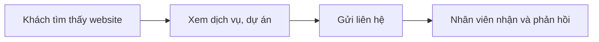

# Tổng quan nghiệp vụ — Website Công ty

> Mô tả demo này cho ai, giải quyết vấn đề gì. Cập nhật khi phạm vi thay đổi.

---

## 1. Thông tin chung

| Mục | Nội dung |
| :--- | :--- |
| Tên demo | Website Công ty |
| Mã dự án | `web-cong-ty` |
| Ngành / loại khách hàng | Doanh nghiệp vừa và nhỏ mọi ngành |
| Loại sản phẩm | Website + trang quản trị nội dung |
| Ý tưởng gốc | 8.1 · Website công ty (`ZDOCS/02-KE-HOACH/DANH-SACH-Y-TUONG.md`) |
| Người phụ trách | |
| Trạng thái | Mới tạo từ khuôn mẫu |

## 2. Vấn đề của khách hàng

- Website cũ, xem trên điện thoại không ổn
- Muốn sửa nội dung phải nhờ lập trình viên
- Không nhận được liên hệ từ website

## 3. Giải pháp demo thể hiện

- Trang chủ, giới thiệu, dịch vụ, dự án tiêu biểu, tin tức, tuyển dụng, liên hệ
- Nhanh, chuẩn SEO, đẹp trên điện thoại
- Quản trị nội dung: bài viết, dịch vụ, dự án, banner
- Form liên hệ đổ về trang quản trị

## 4. Vai trò người dùng

| Vai trò | Mã | Dùng trên | Làm được gì |
| :--- | :--- | :--- | :--- |
| Khách truy cập | — | Điện thoại, desktop | Xem nội dung, gửi liên hệ |
| Quản trị viên | ADMIN | Desktop | Toàn quyền |
| Biên tập viên | MANAGER | Desktop | Quản lý nội dung |
| Nhân viên | STAFF | Desktop | Xử lý liên hệ |

## 5. Phân hệ và chức năng

| Area | Chức năng | Màn hình (route FE dự kiến) | Ưu tiên |
| :--- | :--- | :--- | :---: |
| `System` | Đăng nhập, tài khoản, vai trò, cài đặt | Có sẵn | — |
| `Cms` | Trang chủ, giới thiệu | `/`, `/gioi-thieu` | P1 |
| `Cms` | Dịch vụ | `/dich-vu` | P1 |
| `Cms` | Dự án tiêu biểu | `/du-an` | P1 |
| `Cms` | Tin tức | `/tin-tuc` | P1 |
| `Cms` | Liên hệ, quản lý liên hệ | `/lien-he`, `/admin/contacts` | P1 |
| `Cms` | Quản trị nội dung | `/admin` | P1 |
| `Cms` | Tuyển dụng | `/tuyen-dung` | P2 |
| `Cms` | Song ngữ Việt, Anh | — | P3 |

P1 = bắt buộc có để demo · P2 = nên có · P3 = làm thêm nếu còn thời gian.

## 6. Luồng nghiệp vụ chính

## 7. Phạm vi

**Có trong demo:**

- Website hoàn chỉnh và trang quản trị nội dung

**Không làm (nói rõ với khách nếu được hỏi):**

- Tên miền, hosting thật
- Các kết nối bên ngoài khác chỉ giả lập

## 8. Dữ liệu mẫu cần chuẩn bị

| Dữ liệu | Số lượng | Ghi chú |
| :--- | :---: | :--- |
| Dịch vụ | 6 |  |
| Dự án | 12 | Có ảnh |
| Bài viết | 20 |  |
| Liên hệ | 30 |  |
