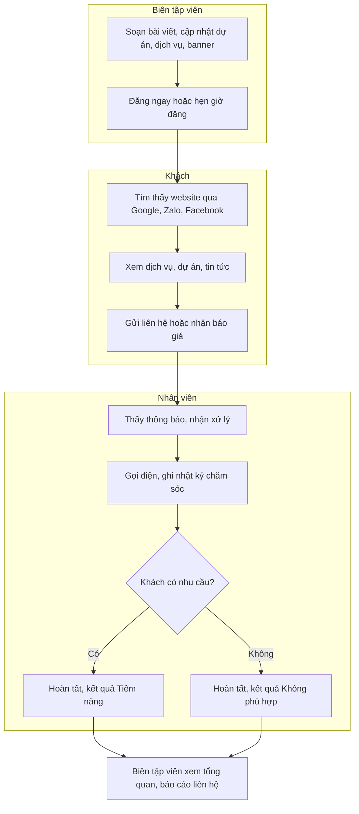
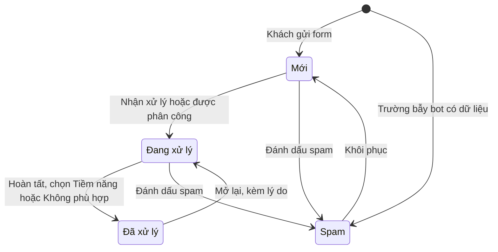
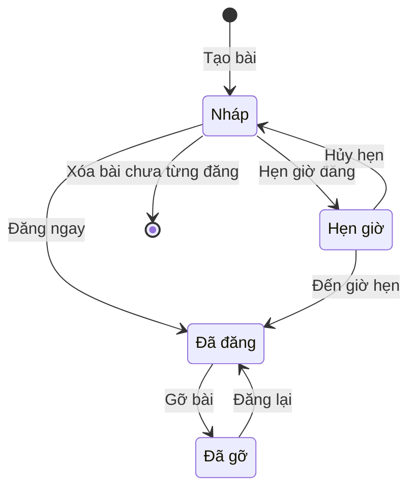
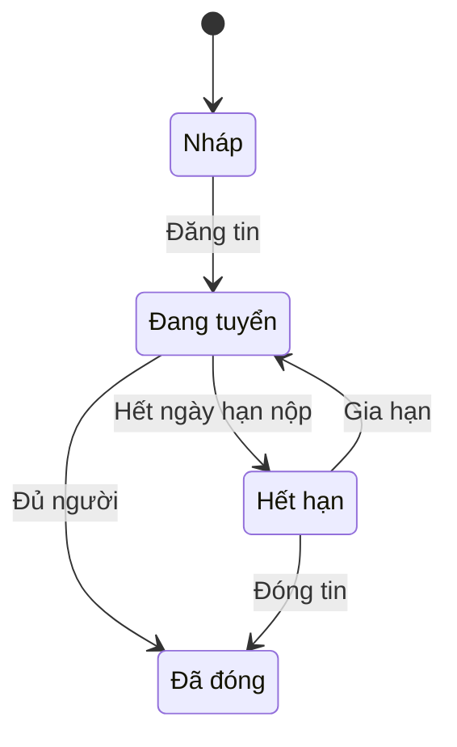

# Đặc tả yêu cầu phần mềm (SRS) — Website Công ty

| Phiên bản | Ngày | Trạng thái |
| :--- | :--- | :--- |
| 1.0 | 12/10/2026 | Bản nháp để triển khai demo |

> Cách viết, quy ước mã, mức độ chi tiết: `ZDOCS/05-HUONG-DAN/HUONG-DAN-VIET-TAI-LIEU-NGHIEP-VU.md`.
> Phần nền (đăng nhập, tài khoản, vai trò, cài đặt, đặt lại dữ liệu demo): `ZDOCS/03-KIEN-TRUC/USE-CASE-NEN.md`, không viết lại ở đây.

---

## 1. Giới thiệu

### 1.1. Mục đích

Tài liệu mô tả đầy đủ yêu cầu của bản demo Website Công ty: các trang công khai, form liên hệ, xử lý liên hệ, quản trị nội dung, tuyển dụng, báo cáo, phân quyền và màn hình. Dev dùng để code, tester dùng để viết và chạy test case, sales dùng để biết demo làm được gì.

### 1.2. Phạm vi

**Trong phạm vi:** trang chủ, giới thiệu, dịch vụ, dự án tiêu biểu, tin tức, liên hệ, tuyển dụng (P2); SEO kỹ thuật (meta, ảnh chia sẻ, sitemap); form liên hệ và nhận báo giá có chống spam; xử lý liên hệ (nhận, nhật ký chăm sóc, kết quả); quản trị banner, nội dung trang, dịch vụ, dự án, bài viết, thư viện ảnh; tổng quan và báo cáo liên hệ; song ngữ Việt, Anh (P3).

**Ngoài phạm vi:** tên miền, hosting, SSL thật; gửi email thật (giả lập); chat trực tuyến thật (nút Zalo, Messenger chỉ mở link); đồng bộ liên hệ sang CRM; bình luận bài viết; bán hàng trực tuyến; Google Analytics, Facebook Pixel thật.

### 1.3. Thuật ngữ

| Thuật ngữ | Giải thích |
| :--- | :--- |
| Khách | Người xem website, không đăng nhập |
| Trang công khai | Các trang khách xem: trang chủ, giới thiệu, dịch vụ, dự án, tin tức, tuyển dụng, liên hệ |
| Trang quản trị | Khu `/admin` dành cho người đã đăng nhập |
| Banner | Ảnh lớn trượt ở đầu trang chủ, có tiêu đề và nút bấm |
| Khối nội dung | Một phần nội dung sửa được của trang chủ, giới thiệu, liên hệ, vd "Con số ấn tượng" |
| Dịch vụ | Mảng kinh doanh công ty cung cấp, vd "Thi công nội thất trọn gói" |
| Dự án | Công trình đã thực hiện, có ảnh, dùng để giới thiệu năng lực |
| Bài viết | Tin tức, kiến thức đăng ở mục Tin tức |
| Chuyên mục | Nhóm bài viết, vd "Kiến thức nội thất" |
| Slug | Phần cuối đường dẫn của một nội dung, vd `thi-cong-noi-that-tron-goi` |
| SEO | Các thông tin giúp Google, Zalo, Facebook đọc đúng tiêu đề, mô tả, ảnh của trang |
| Liên hệ | Yêu cầu khách gửi qua form trên website |
| Nguồn liên hệ | Nơi khách gửi: Trang Liên hệ, Nhận báo giá, Dự án tương tự |
| Nhận xử lý | Nhân viên nhận một liên hệ Mới về mình phụ trách |
| Nhật ký chăm sóc | Ghi chép mỗi lần nhân viên liên lạc với khách |
| Quá hạn | Liên hệ Mới chưa ai nhận sau 24 giờ |
| Trễ hẹn | Liên hệ có giờ hẹn gọi lại đã qua mà chưa có nhật ký mới |
| Tiềm năng | Kết quả xử lý: khách có nhu cầu thật, chuyển sang khảo sát, báo giá |
| Thời gian phản hồi | Khoảng thời gian từ lúc khách gửi tới lúc có người nhận xử lý |
| Tin tuyển dụng | Một vị trí đang tuyển đăng ở mục Tuyển dụng |
| Hồ sơ ứng tuyển | Thông tin và CV ứng viên gửi cho một tin tuyển dụng |

### 1.4. Tài liệu liên quan

| Tài liệu | Nội dung |
| :--- | :--- |
| `01-TONG-QUAN-NGHIEP-VU.md` | Tổng quan nghiệp vụ |
| `03-USE-CASE.md` | Đặc tả use case |
| `05-KICH-BAN-KIEM-THU.md` | Test case nghiệm thu, dữ liệu mẫu dùng trong test |
| `ZDOCS/03-KIEN-TRUC/USE-CASE-NEN.md` | Phần nền dùng chung |

---

## 2. Mô tả tổng quan

### 2.1. Bối cảnh sản phẩm

Doanh nghiệp vừa và nhỏ cần một website giới thiệu đẹp trên điện thoại, tự cập nhật nội dung, và không bỏ sót khách để lại thông tin. Dữ liệu mẫu là công ty thiết kế, thi công nội thất "Nội thất Lam Sơn" (Công ty TNHH Kiến trúc và Nội thất Lam Sơn), vì ngành này cần nhiều ảnh dự án và có nhiều khách hỏi báo giá. Khách tìm thấy website qua Google, Zalo, Facebook, xem dự án rồi gửi yêu cầu. Nhân viên kinh doanh nhận liên hệ trên trang quản trị, gọi lại và ghi kết quả. Biên tập viên (thường là trưởng phòng marketing) đăng bài, cập nhật dự án, banner và theo dõi website mang về bao nhiêu khách.

### 2.2. Tác nhân

| Mã vai trò | Tên | Thiết bị | Mục tiêu khi dùng hệ thống |
| :--- | :--- | :--- | :--- |
| — | Khách | Điện thoại, desktop | Xem năng lực công ty, gửi yêu cầu tư vấn, báo giá, ứng tuyển |
| `STAFF` | Nhân viên | Desktop, điện thoại | Nhận liên hệ nhanh, gọi lại khách, ghi nhật ký, không bỏ sót khách; xử lý hồ sơ ứng tuyển |
| `MANAGER` | Biên tập viên | Desktop | Cập nhật nội dung không cần lập trình viên, theo dõi liên hệ và báo cáo, chuyển người xử lý |
| `ADMIN` | Quản trị viên | Desktop | Cấu hình hệ thống, tài khoản, phân quyền, thương hiệu, xóa dữ liệu cá nhân theo yêu cầu |

Tài khoản demo: `admin`, `quanly` (Biên tập viên), `nhanvien`. Khách không cần tài khoản.

### 2.3. Quy trình nghiệp vụ

### 2.4. Giả định và ràng buộc

- Một website, một công ty. Tên, logo, màu, địa chỉ, hotline lấy từ cài đặt chung (UC-SYS-07); tên thương hiệu ngắn dùng trong tiêu đề SEO là "Nội thất Lam Sơn".
- Email xác nhận gửi khách và email báo liên hệ mới là giả lập: hệ thống ghi vào nhật ký với nhãn "Email giả lập", không gửi thật.
- Bản đồ dùng khung nhúng Google Maps theo link cấu hình, không dùng khóa API. Nút Zalo mở `https://zalo.me/{số điện thoại}`, nút Messenger mở `https://m.me/{tên trang}`.
- Sau khi đăng nhập, trang mặc định là Tổng quan quản trị `/admin`.
- Giờ tính theo múi giờ Việt Nam (UTC+7); "24 giờ" tính theo giờ đồng hồ, không trừ ngày nghỉ.
- Ở chế độ `mock`, ảnh và CV tải lên lưu tạm trong trình duyệt và mất khi đặt lại dữ liệu.
- Website không bán hàng trực tuyến, nên không cần chức năng giỏ hàng, thanh toán.

---

## 3. Yêu cầu chức năng

### 3.1. Trang công khai

| Mã | Yêu cầu | Ưu tiên | Vai trò | UC |
| :--- | :--- | :---: | :--- | :--- |
| FR-01 | Mọi trang công khai có đầu trang gồm logo, menu (Trang chủ, Giới thiệu, Dịch vụ, Dự án, Tin tức, Tuyển dụng, Liên hệ), hotline, nút "Nhận báo giá"; chân trang gồm thông tin công ty, mạng xã hội, link nhanh. Trên điện thoại menu thu vào một nút | P1 | Khách | UC-01 |
| FR-02 | Mọi trang công khai có nút nổi Gọi điện, Zalo, Messenger lấy số và link từ cài đặt; trên điện thoại bấm Gọi điện thì máy gọi ngay | P2 | Khách | UC-01 |
| FR-03 | Trang chủ gồm banner trượt (BR-15), giới thiệu ngắn, dịch vụ nổi bật, con số ấn tượng, dự án nổi bật, logo khách hàng, 3 bài viết mới (BR-16) và khối "Nhận tư vấn miễn phí" | P1 | Khách | UC-01 |
| FR-04 | Trang Giới thiệu gồm lịch sử hình thành, tầm nhìn, sứ mệnh, giá trị cốt lõi, đội ngũ lãnh đạo, chứng nhận và giải thưởng | P1 | Khách | UC-01 |
| FR-05 | Trang Dịch vụ liệt kê dịch vụ đang hiển thị kèm biểu tượng, mô tả ngắn, giá tham khảo; trang chi tiết dịch vụ có nội dung, các bước quy trình, giá tham khảo (BR-17), câu hỏi thường gặp, tối đa 3 dự án liên quan và nút "Nhận báo giá" | P1 | Khách | UC-02 |
| FR-06 | Trang Dự án hiển thị lưới dự án có ảnh bìa, lọc theo loại công trình, dịch vụ, năm hoàn thành, 12 dự án mỗi trang; trang chi tiết có loại công trình, địa điểm, diện tích, năm, mô tả, thư viện ảnh phóng to và nút "Tư vấn công trình tương tự" | P1 | Khách | UC-02 |
| FR-07 | Trang Tin tức liệt kê bài đã đăng theo chuyên mục, 9 bài mỗi trang, có tìm kiếm; trang chi tiết bài có ngày đăng, ngày cập nhật, thời gian đọc (BR-12), nội dung, 3 bài liên quan cùng chuyên mục, nút chia sẻ Facebook, Zalo, sao chép link | P1 | Khách | UC-02 |
| FR-08 | Mọi trang công khai có tiêu đề, mô tả meta, ảnh chia sẻ Open Graph, đường dẫn chuẩn (canonical), dữ liệu có cấu trúc schema.org (Organization ở trang chủ, Article ở bài viết); hệ thống tự sinh `sitemap.xml` và `robots.txt` (BR-11) | P1 | Khách | UC-02, UC-04 |

### 3.2. Liên hệ

| Mã | Yêu cầu | Ưu tiên | Vai trò | UC |
| :--- | :--- | :---: | :--- | :--- |
| FR-09 | Form liên hệ gồm họ tên, số điện thoại, email, dịch vụ quan tâm, ngân sách dự kiến, diện tích, nội dung, ô đồng ý xử lý dữ liệu cá nhân; hệ thống kiểm tra từng ô khi khách rời ô (BR-01, BR-02) | P1 | Khách | UC-03 |
| FR-10 | Gửi thành công, hệ thống hiển thị lời cảm ơn kèm mã liên hệ và cam kết phản hồi trong 24 giờ; gửi email xác nhận cho khách (nếu có email) và email báo hộp thư nhận liên hệ (giả lập) | P1 | Khách | UC-03 |
| FR-11 | Hệ thống chống spam và gộp liên hệ trùng theo BR-03 | P1 | Khách | UC-03 |
| FR-12 | Trang Liên hệ hiển thị địa chỉ, điện thoại, email, giờ làm việc, bản đồ nhúng và form liên hệ. Nút "Nhận báo giá" ở trang dịch vụ mở form dạng hộp thoại có sẵn dịch vụ; nút "Tư vấn công trình tương tự" ở trang dự án mở form có sẵn tên dự án trong nội dung | P1 | Khách | UC-03 |

### 3.3. Xử lý liên hệ

| Mã | Yêu cầu | Ưu tiên | Vai trò | UC |
| :--- | :--- | :---: | :--- | :--- |
| FR-13 | Danh sách liên hệ hiển thị mã, thời gian gửi, họ tên, số điện thoại, nguồn, dịch vụ quan tâm, ngân sách, trạng thái, người xử lý, nhãn Quá hạn, Trễ hẹn; lọc theo trạng thái, nguồn, dịch vụ, người xử lý, khoảng ngày; tìm theo tên, số điện thoại, mã | P1 | STAFF, MANAGER | UC-05 |
| FR-14 | Trang quản trị có chuông thông báo hiển thị số liên hệ Mới chưa ai nhận, tự cập nhật mỗi 60 giây | P2 | STAFF, MANAGER | UC-05 |
| FR-15 | Nhân viên bấm "Nhận xử lý" để nhận liên hệ Mới; Biên tập viên, Quản trị viên chuyển người xử lý của liên hệ (BR-07) | P1 | STAFF, MANAGER | UC-05 |
| FR-16 | Nhân viên ghi nhật ký chăm sóc gồm kênh (Gọi điện, Zalo, Email, Gặp trực tiếp), kết quả liên lạc (Đã trao đổi, Không nghe máy, Hẹn gọi lại), nội dung, giờ hẹn gọi lại; chi tiết liên hệ hiển thị toàn bộ nhật ký theo thời gian | P1 | STAFF | UC-05 |
| FR-17 | Nhân viên chuyển trạng thái liên hệ theo BR-05: hoàn tất với kết quả Tiềm năng hoặc Không phù hợp, đánh dấu Spam, khôi phục, mở lại | P1 | STAFF | UC-05 |
| FR-18 | Biên tập viên xuất danh sách liên hệ đang lọc ra file Excel | P2 | MANAGER | UC-05, UC-07 |
| FR-19 | Chi tiết liên hệ có nút gọi nhanh (`tel:`) và nút mở Zalo theo số điện thoại của khách | P2 | STAFF | UC-05 |

### 3.4. Quản trị nội dung

| Mã | Yêu cầu | Ưu tiên | Vai trò | UC |
| :--- | :--- | :---: | :--- | :--- |
| FR-20 | Biên tập viên thêm, sửa, bật/tắt, sắp xếp banner trang chủ: ảnh máy tính, ảnh điện thoại, tiêu đề, mô tả, nhãn nút, link, khoảng hiển thị | P1 | MANAGER | UC-08 |
| FR-21 | Biên tập viên sửa khối nội dung của trang chủ (giới thiệu ngắn, 4 con số ấn tượng, logo khách hàng), trang Giới thiệu (các khối nội dung, đội ngũ, chứng nhận) và trang Liên hệ (giờ làm việc, link bản đồ, mạng xã hội), xem trước rồi lưu | P1 | MANAGER | UC-08 |
| FR-22 | Biên tập viên thêm, sửa, ẩn, sắp xếp dịch vụ: tên, slug, biểu tượng, ảnh, mô tả ngắn, nội dung, các bước quy trình, giá tham khảo, câu hỏi thường gặp, nổi bật trang chủ | P1 | MANAGER | UC-06 |
| FR-23 | Biên tập viên thêm, sửa, ẩn, sắp xếp dự án: tên, slug, loại công trình, dịch vụ, địa điểm, năm hoàn thành, diện tích, mô tả, ảnh bìa, bộ ảnh, nổi bật trang chủ | P1 | MANAGER | UC-06 |
| FR-24 | Biên tập viên soạn bài viết bằng trình soạn thảo trực quan (tiêu đề mục, đoạn văn, in đậm, danh sách, ảnh, link, bảng, video YouTube), chọn chuyên mục, thẻ, ảnh đại diện, nhập tóm tắt, ghim bài | P1 | MANAGER | UC-04 |
| FR-25 | Biên tập viên lưu nháp, xem trước, đăng ngay, hẹn giờ đăng, gỡ bài, đăng lại theo BR-10, BR-11 | P1 | MANAGER | UC-04 |
| FR-26 | Bài viết, dịch vụ, dự án có khu SEO: tiêu đề SEO, mô tả meta, slug, ảnh chia sẻ; hiển thị bản xem trước kết quả Google, bộ đếm ký tự và cảnh báo theo BR-09 | P1 | MANAGER | UC-04, UC-06 |
| FR-27 | Biên tập viên thêm, sửa, sắp xếp, ẩn chuyên mục tin tức | P2 | MANAGER | UC-04 |
| FR-28 | Thư viện ảnh dùng chung: tải lên, tìm theo tên, chèn lại ảnh đã tải vào bài viết, dịch vụ, dự án, banner; hệ thống tự nén theo BR-14 | P2 | MANAGER | UC-04, UC-06 |

### 3.5. Tổng quan và báo cáo

| Mã | Yêu cầu | Ưu tiên | Vai trò | UC |
| :--- | :--- | :---: | :--- | :--- |
| FR-29 | Trang Tổng quan quản trị hiển thị số liên hệ mới hôm nay, chưa nhận, quá hạn, tỉ lệ tiềm năng 30 ngày; biểu đồ cột liên hệ 30 ngày theo nguồn; 5 liên hệ mới nhất; 5 bài viết xem nhiều nhất 30 ngày; bài hẹn giờ sắp đăng. Nhân viên chỉ thấy thẻ liên hệ: Mới chưa nhận, Của tôi đang xử lý, Quá hạn, Trễ hẹn của tôi | P1 | MANAGER, STAFF | UC-07 |
| FR-30 | Báo cáo liên hệ theo khoảng ngày: theo ngày, nguồn, dịch vụ quan tâm, ngân sách, người xử lý (số nhận, số hoàn tất, thời gian phản hồi trung bình, tỉ lệ tiềm năng, số quá hạn) theo BR-21 | P2 | MANAGER | UC-07 |

### 3.6. Tuyển dụng

| Mã | Yêu cầu | Ưu tiên | Vai trò | UC |
| :--- | :--- | :---: | :--- | :--- |
| FR-31 | Trang Tuyển dụng liệt kê tin đang tuyển (vị trí, nơi làm việc, mức lương, hạn nộp); trang chi tiết có mô tả, yêu cầu, quyền lợi và form ứng tuyển kèm CV (BR-20) | P2 | Khách | UC-09 |
| FR-32 | Biên tập viên thêm, sửa, đóng tin tuyển dụng; tin tự hết hạn theo BR-19 | P2 | MANAGER | UC-10 |
| FR-33 | Nhân viên xem hồ sơ ứng tuyển theo tin, tải CV, đổi trạng thái hồ sơ (Mới, Đã xem, Hẹn phỏng vấn, Đạt, Không đạt), ghi chú | P2 | STAFF, MANAGER | UC-10 |

### 3.7. Song ngữ và dữ liệu cá nhân

| Mã | Yêu cầu | Ưu tiên | Vai trò | UC |
| :--- | :--- | :---: | :--- | :--- |
| FR-34 | Khách chuyển ngôn ngữ Việt, Anh ở đầu trang; Biên tập viên nhập bản tiếng Anh cho banner, khối nội dung, dịch vụ, dự án, bài viết (BR-23) | P3 | Khách, MANAGER | UC-11 |
| FR-35 | Quản trị viên xóa vĩnh viễn liên hệ khi khách yêu cầu xóa dữ liệu cá nhân (BR-22) | P3 | ADMIN | UC-05 |

---

## 4. Quy tắc nghiệp vụ

| Mã | Quy tắc | Áp dụng cho |
| :--- | :--- | :--- |
| BR-01 | Số điện thoại: hệ thống bỏ khoảng trắng, dấu `.` và `-`, đổi đầu `+84` hoặc `84` thành `0` rồi kiểm tra. Hợp lệ khi là số di động 10 chữ số bắt đầu bằng `03`, `05`, `07`, `08`, `09` hoặc số cố định 11 chữ số bắt đầu bằng `02`. Lưu dạng đã chuẩn hóa, vd `+84 912 345 678` lưu `0912345678` | FR-09, FR-31 |
| BR-02 | Form liên hệ: họ tên 2–100 ký tự, số điện thoại theo BR-01, nội dung 10–2.000 ký tự và ô đồng ý xử lý dữ liệu cá nhân là bắt buộc. Email không bắt buộc, nhập thì phải đúng định dạng. Diện tích nếu nhập là số 1–10.000 m². Hệ thống lưu thời điểm khách tick đồng ý | FR-09 |
| BR-03 | Thứ tự kiểm tra khi khách gửi: (1) trường ẩn bẫy bot có dữ liệu thì vẫn báo thành công nhưng lưu liên hệ trạng thái Spam, không gửi thông báo; (2) mỗi địa chỉ IP gửi tối đa 3 liên hệ trong 10 phút, lần thứ 4 bị từ chối; (3) cùng số điện thoại đã có liên hệ Mới hoặc Đang xử lý gửi trong 24 giờ gần nhất thì không tạo liên hệ mới, nội dung mới được ghi vào nhật ký của liên hệ cũ với dòng "Khách gửi lại", khách thấy thông báo thành công với mã cũ | FR-11 |
| BR-04 | Mã liên hệ: `LH` + `yyMMdd` + số thứ tự 3 chữ số trong ngày, vd `LH261012003`. Mã hồ sơ ứng tuyển: `UV` + `yyMMdd` + 3 chữ số, vd `UV261012001` | FR-10, FR-31 |
| BR-05 | Trạng thái liên hệ: Mới → Đang xử lý khi nhân viên nhận hoặc được phân công. Đang xử lý → Đã xử lý khi có ít nhất 1 nhật ký chăm sóc do nhân viên ghi (dòng "Khách gửi lại" không tính), chọn kết quả Tiềm năng hoặc Không phù hợp và ghi chú tối thiểu 10 ký tự. Mới hoặc Đang xử lý → Spam. Spam → Mới khi khôi phục. Đã xử lý → Đang xử lý khi mở lại, bắt buộc nhập lý do | FR-15, FR-17 |
| BR-06 | Liên hệ Mới chưa ai nhận quá 24 giờ kể từ lúc gửi có nhãn đỏ "Quá hạn". Liên hệ Đang xử lý có giờ hẹn gọi lại đã qua mà chưa có nhật ký mới sau giờ hẹn có nhãn cam "Trễ hẹn" | FR-10, FR-13, FR-29 |
| BR-07 | Nhân viên chỉ thấy liên hệ Mới chưa ai nhận và liên hệ đang giao cho mình; Biên tập viên, Quản trị viên thấy tất cả và chuyển người xử lý được. Hai người cùng bấm "Nhận xử lý" thì người bấm trước được nhận, người sau nhận thông báo "Liên hệ đã được {tên} nhận" | FR-13, FR-15 |
| BR-08 | Slug gồm chữ thường không dấu, số, dấu `-`, tối đa 80 ký tự, không trùng trong cùng loại nội dung (dịch vụ, dự án, bài viết, tin tuyển dụng); tự sinh từ tiêu đề, trùng thì thêm `-2`, `-3`. Đổi slug của nội dung đã từng hiển thị công khai thì slug cũ chuyển hướng 301 tới slug mới | FR-08, FR-22, FR-23, FR-24 |
| BR-09 | Tiêu đề SEO để trống thì dùng "{tiêu đề} \| {tên thương hiệu}". Mô tả meta để trống thì lấy tóm tắt (hoặc mô tả ngắn); dài hơn 160 ký tự thì cắt ở ranh giới từ trong 155 ký tự đầu và thêm "…". Tiêu đề SEO trên 60 ký tự hoặc mô tả meta trên 160 ký tự thì hiện cảnh báo vàng, vẫn lưu được | FR-08, FR-26 |
| BR-10 | Đăng bài cần: tiêu đề 10–120 ký tự, chuyên mục, ảnh đại diện có văn bản thay thế, tóm tắt 50–300 ký tự, nội dung tối thiểu 300 ký tự. Giờ hẹn đăng phải sau thời điểm hiện tại ít nhất 5 phút; bài Hẹn giờ tự chuyển Đã đăng trong vòng 1 phút sau giờ hẹn | FR-25 |
| BR-11 | Ngày đăng là thời điểm đăng lần đầu, không đổi khi sửa hoặc đăng lại; sửa bài đã đăng thì hiện thêm "Cập nhật dd/MM/yyyy". Bài Nháp, Hẹn giờ, Đã gỡ và dịch vụ, dự án đang ẩn trả trang 404 ở phía công khai và không có trong `sitemap.xml` | FR-07, FR-08, FR-25 |
| BR-12 | Thời gian đọc = số từ của nội dung ÷ 200, làm tròn lên, tối thiểu 1 phút. Vd 1.150 từ hiển thị "6 phút đọc"; 800 từ hiển thị "4 phút đọc" | FR-07 |
| BR-13 | Lượt xem bài viết: cùng trình duyệt xem lại cùng bài trong 30 phút không tính thêm; không tính người đang đăng nhập trang quản trị và bot (user agent chứa `bot`, `crawler`, `spider`) | FR-07, FR-29 |
| BR-14 | Ảnh: JPG, PNG, WebP, tối đa 5 MB mỗi ảnh. Hệ thống tạo bản WebP rộng 1920, 960 và 480 px, dùng bản phù hợp theo màn hình. Ảnh đại diện, ảnh bìa, ảnh banner bắt buộc có văn bản thay thế 5–125 ký tự. Ảnh banner máy tính rộng tối thiểu 1440 px. Bộ ảnh mỗi dự án tối đa 20 ảnh | FR-20, FR-23, FR-24, FR-28 |
| BR-15 | Banner hiển thị khi đang bật và thời điểm hiện tại nằm trong khoảng hiển thị (để trống là không giới hạn); ngày kết thúc phải sau ngày bắt đầu. Trạng thái tính ra: Tắt, Chờ hiển thị, Đang hiển thị, Hết hạn. Tối đa 5 banner đang bật ở trạng thái Chờ hiển thị hoặc Đang hiển thị. Banner tự chuyển sau 6 giây, dừng khi khách chạm hoặc rê chuột. Thiếu ảnh điện thoại thì dùng ảnh máy tính cắt giữa | FR-03, FR-20 |
| BR-16 | Trang chủ hiển thị tối đa 6 dịch vụ nổi bật và 6 dự án nổi bật theo thứ tự sắp xếp; 3 bài viết mới nhất theo ngày đăng, bài ghim đứng đầu. Tối đa 1 bài ghim: ghim bài mới thì bài ghim cũ tự bỏ ghim | FR-03, FR-22, FR-23, FR-24 |
| BR-17 | Giá tham khảo nhập dạng số tiền (bội số 1.000 ₫) và đơn vị tính (m², m dài, bộ, gói), hiển thị "từ 4.500.000 ₫/m²"; để trống thì hiển thị "Liên hệ báo giá" | FR-05, FR-22 |
| BR-18 | Không xóa dịch vụ đang gắn với dự án hoặc liên hệ, không xóa chuyên mục còn bài viết: chỉ ẩn được. Chỉ xóa được bài viết Nháp chưa từng đăng; bài đã từng đăng chỉ gỡ được | FR-22, FR-25, FR-27 |
| BR-19 | Tin tuyển dụng: hạn nộp không trước ngày đăng; sau 23:59 ngày hạn nộp tin tự chuyển Hết hạn, ẩn form ứng tuyển, trang tin vẫn mở được với nhãn "Đã hết hạn". Mức lương hiển thị theo khoảng nhập, vd "15 – 25 triệu", hoặc "Thỏa thuận" khi để trống | FR-31, FR-32 |
| BR-20 | Ứng tuyển bắt buộc họ tên, số điện thoại (BR-01), email, CV dạng PDF, DOC hoặc DOCX tối đa 5 MB. Một số điện thoại chỉ ứng tuyển một tin một lần; lần sau báo "Bạn đã ứng tuyển vị trí này ngày dd/MM/yyyy" | FR-31 |
| BR-21 | Chỉ số báo cáo không tính liên hệ Spam; kỳ báo cáo tính theo thời điểm khách gửi. Thời gian phản hồi = thời điểm nhận xử lý − thời điểm gửi; trung bình tính trên các liên hệ đã được nhận, hiển thị "x giờ y phút". Tỉ lệ tiềm năng = số liên hệ Đã xử lý có kết quả Tiềm năng ÷ số liên hệ Đã xử lý × 100%, làm tròn 1 chữ số thập phân; mẫu số bằng 0 thì hiển thị "—" | FR-29, FR-30 |
| BR-22 | Chỉ Quản trị viên xóa vĩnh viễn được liên hệ, khi khách yêu cầu xóa dữ liệu cá nhân; bắt buộc nhập lý do. Nhật ký thao tác ghi mã liên hệ, người xóa, lý do, không giữ lại thông tin cá nhân đã xóa | FR-35 |
| BR-23 | Trang tiếng Anh có tiền tố `/en`. Nội dung chưa có bản tiếng Anh thì hiển thị bản tiếng Việt kèm dòng "This content is available in Vietnamese only" | FR-34 |

---

## 5. Yêu cầu dữ liệu

### 5.1. Thực thể

| Thực thể | Mô tả | Thuộc tính chính | Quan hệ |
| :--- | :--- | :--- | :--- |
| Banner | Ảnh lớn đầu trang chủ | Tiêu đề, mô tả, ảnh máy tính, ảnh điện thoại, văn bản thay thế, nhãn nút, link, hiển thị từ–đến, bật/tắt, thứ tự | — |
| Khối nội dung | Phần sửa được của trang chủ, giới thiệu, liên hệ | Trang, mã khối, tiêu đề, nội dung, ảnh, thứ tự | — |
| Con số ấn tượng | Số liệu nổi bật ở trang chủ | Giá trị, hậu tố (vd "+"), nhãn, thứ tự | Thuộc khối nội dung trang chủ |
| Thành viên đội ngũ | Người giới thiệu ở trang Giới thiệu | Họ tên, chức danh, ảnh, giới thiệu ngắn, thứ tự | — |
| Logo khách hàng | Khách hàng, đối tác tiêu biểu | Tên, logo, link, thứ tự | — |
| Dịch vụ | Mảng kinh doanh | Tên, slug, biểu tượng, ảnh, mô tả ngắn, nội dung, giá tham khảo, đơn vị tính, hiển thị, nổi bật, thứ tự, SEO | Có nhiều bước quy trình, câu hỏi thường gặp; gắn với nhiều dự án, liên hệ |
| Bước quy trình | Một bước làm việc của dịch vụ | Tên bước, mô tả, thứ tự | Thuộc một dịch vụ |
| Câu hỏi thường gặp | Hỏi đáp của dịch vụ | Câu hỏi, trả lời, thứ tự | Thuộc một dịch vụ |
| Dự án | Công trình đã làm | Tên, slug, loại công trình (Căn hộ, Nhà phố, Biệt thự, Văn phòng, Showroom), địa điểm (tỉnh/thành), năm hoàn thành, diện tích, mô tả, ảnh bìa, hiển thị, nổi bật, thứ tự, SEO | Gắn 1–3 dịch vụ; có nhiều ảnh dự án |
| Ảnh dự án | Ảnh trong bộ ảnh dự án | Ảnh, chú thích, thứ tự | Thuộc một dự án |
| Chuyên mục | Nhóm bài viết | Tên, slug, thứ tự, hiển thị | Có nhiều bài viết |
| Bài viết | Tin tức, kiến thức | Tiêu đề, slug, tóm tắt, nội dung, ảnh đại diện, văn bản thay thế, thẻ, trạng thái, ngày đăng, giờ hẹn, ngày cập nhật, ghim, lượt xem, tác giả, SEO | Thuộc một chuyên mục |
| Ảnh thư viện | Ảnh dùng chung | Tên tệp, các bản WebP, văn bản thay thế mặc định, kích thước, người tải, ngày tải | Dùng ở nhiều nội dung |
| Slug cũ | Slug trước khi đổi | Loại nội dung, nội dung, slug | Thuộc một dịch vụ, dự án, bài viết hoặc tin tuyển dụng |
| Liên hệ | Yêu cầu của khách | Mã, họ tên, số điện thoại, email, ngân sách dự kiến, diện tích, nội dung, nguồn, trang gửi, thời điểm đồng ý dữ liệu, địa chỉ IP, trạng thái, kết quả, ghi chú kết quả, thời điểm gửi, thời điểm nhận, thời điểm hoàn tất | Gắn một dịch vụ quan tâm; giao cho một người xử lý; có nhiều nhật ký chăm sóc |
| Nhật ký chăm sóc | Một lần liên lạc với khách | Kênh, kết quả liên lạc, nội dung, giờ hẹn gọi lại, người ghi, thời điểm | Thuộc một liên hệ |
| Tin tuyển dụng | Vị trí đang tuyển | Vị trí, slug, phòng ban, nơi làm việc, số lượng, lương từ–đến, kinh nghiệm, hạn nộp, mô tả, yêu cầu, quyền lợi, trạng thái | Có nhiều hồ sơ ứng tuyển |
| Hồ sơ ứng tuyển | Hồ sơ ứng viên | Mã, họ tên, số điện thoại, email, tệp CV, thư giới thiệu, trạng thái, ghi chú, thời điểm nộp | Thuộc một tin tuyển dụng |

Ngân sách dự kiến chọn một trong: Dưới 100 triệu, 100–300 triệu, 300–500 triệu, 500 triệu – 1 tỷ, Trên 1 tỷ, Chưa xác định.

### 5.2. Vòng đời

**Liên hệ**

Nhãn Quá hạn, Trễ hẹn không phải trạng thái, chỉ là cờ tính theo BR-06.

**Bài viết**

**Tin tuyển dụng**

**Banner:** trạng thái tính theo công tắc và khoảng hiển thị (BR-15): Tắt; Chờ hiển thị (bật, chưa tới ngày bắt đầu); Đang hiển thị; Hết hạn (bật, đã qua ngày kết thúc).

**Hồ sơ ứng tuyển:** Mới → Đã xem (khi mở hồ sơ lần đầu) → Hẹn phỏng vấn → Đạt hoặc Không đạt; từ Mới hoặc Đã xem chuyển thẳng Không đạt được.

### 5.3. Mã chứng từ

| Chứng từ | Định dạng | Ví dụ |
| :--- | :--- | :--- |
| Liên hệ | `LH` + `yyMMdd` + 3 số | `LH261012003` |
| Hồ sơ ứng tuyển | `UV` + `yyMMdd` + 3 số | `UV261012001` |
| Slug | Chữ thường không dấu, số, `-`, tối đa 80 ký tự | `thi-cong-noi-that-tron-goi` |

---

## 6. Báo cáo

| Báo cáo | Chỉ số | Bộ lọc | Vai trò |
| :--- | :--- | :--- | :--- |
| Tổng quan quản trị | Liên hệ mới hôm nay, chưa nhận, quá hạn, tỉ lệ tiềm năng 30 ngày, biểu đồ liên hệ 30 ngày theo nguồn, 5 liên hệ mới nhất, top 5 bài xem nhiều, bài hẹn giờ | — | MANAGER (STAFF chỉ thấy thẻ liên hệ của mình) |
| Liên hệ theo ngày | Số liên hệ mỗi ngày, chia theo nguồn | Khoảng ngày | MANAGER |
| Theo dịch vụ quan tâm | Số liên hệ, số tiềm năng, tỉ lệ tiềm năng mỗi dịch vụ | Khoảng ngày | MANAGER |
| Theo ngân sách | Số liên hệ, tỉ trọng mỗi mức ngân sách | Khoảng ngày, dịch vụ | MANAGER |
| Theo người xử lý | Số nhận, số hoàn tất, thời gian phản hồi trung bình, tỉ lệ tiềm năng, số quá hạn | Khoảng ngày | MANAGER |
| Bài viết xem nhiều | Lượt xem, ngày đăng, chuyên mục | Khoảng ngày, chuyên mục | MANAGER |

---

## 7. Phân quyền

> Quyền nền (`dashboard`, `users`, `roles`, `settings`, `audit-logs`) xem `USE-CASE-NEN.md` §7. Trang công khai không cần quyền.

| Mã quyền | Mô tả | ADMIN | MANAGER | STAFF |
| :--- | :--- | :---: | :---: | :---: |
| `banners.view` / `create` / `update` / `delete` | Quản lý banner trang chủ | ✓ | ✓ | |
| `pages.view` / `update` | Sửa khối nội dung trang chủ, giới thiệu, liên hệ | ✓ | ✓ | |
| `services.view` / `create` / `update` / `delete` | Quản lý dịch vụ | ✓ | ✓ | |
| `projects.view` / `create` / `update` / `delete` | Quản lý dự án | ✓ | ✓ | |
| `posts.view` / `create` / `update` / `delete` | Soạn, sửa, xóa bài nháp | ✓ | ✓ | |
| `posts.publish` | Đăng, hẹn giờ, gỡ, đăng lại bài | ✓ | ✓ | |
| `post-categories.view` / `create` / `update` / `delete` | Quản lý chuyên mục | ✓ | ✓ | |
| `media-files.view` / `create` / `delete` | Thư viện ảnh | ✓ | ✓ | |
| `contacts.view` | Xem liên hệ (Nhân viên: liên hệ Mới chưa nhận và liên hệ của mình) | ✓ | ✓ | ✓ |
| `contacts.update` | Nhận xử lý, ghi nhật ký, đổi trạng thái | ✓ | ✓ | ✓ |
| `contacts.assign` | Chuyển người xử lý | ✓ | ✓ | |
| `contacts.export` | Xuất Excel danh sách liên hệ | ✓ | ✓ | |
| `contacts.delete` | Xóa vĩnh viễn liên hệ theo yêu cầu của khách | ✓ | | |
| `jobs.view` / `create` / `update` / `delete` | Quản lý tin tuyển dụng | ✓ | ✓ | |
| `job-applications.view` / `update` | Xem, xử lý hồ sơ ứng tuyển | ✓ | ✓ | ✓ |
| `reports.view` | Xem chỉ số, biểu đồ ở Tổng quan và Báo cáo liên hệ | ✓ | ✓ | |

---

## 8. Yêu cầu phi chức năng

> Yêu cầu chung (bảo mật JWT, phân quyền, tiếng Việt, chế độ dữ liệu mẫu) theo `ZDOCS/03-KIEN-TRUC/KIEN-TRUC-HE-THONG.md`. Ở đây chỉ ghi yêu cầu riêng của dự án.

| Mã | Yêu cầu |
| :--- | :--- |
| NFR-01 | Trang chủ, chi tiết dự án, chi tiết bài viết đạt điểm Lighthouse trên điện thoại: Performance từ 90, SEO từ 95, Accessibility từ 90, Best Practices từ 90 |
| NFR-02 | Trên mạng 4G mô phỏng: LCP dưới 2,5 giây, CLS dưới 0,1, INP dưới 200 ms; ảnh WebP, tải lười ngoài màn hình đầu |
| NFR-03 | Hiển thị đúng từ 360 px tới 1920 px, không cuộn ngang; vùng chạm tối thiểu 44×44 px; nút liên hệ nổi không che nút "Gửi" của form |
| NFR-04 | Trang công khai render sẵn phía máy chủ; nội dung vừa đăng, sửa, ẩn hiển thị đúng ở phía công khai và `sitemap.xml` trong vòng 60 giây |
| NFR-05 | Gửi form liên hệ phản hồi dưới 2 giây; mất kết nối thì giữ nguyên dữ liệu đã nhập, báo lỗi, cho gửi lại và không tạo trùng liên hệ |
| NFR-06 | Trình soạn thảo tự lưu nháp mỗi 30 giây; rời trang khi còn thay đổi chưa lưu thì hỏi xác nhận |
| NFR-07 | Dữ liệu cá nhân trong liên hệ và hồ sơ ứng tuyển chỉ người có quyền mới xem; mỗi lần xuất Excel liên hệ ghi nhật ký người xuất, bộ lọc, số dòng |
| NFR-08 | Dữ liệu mẫu có 30 liên hệ trải đều 90 ngày, đủ các trạng thái; luôn có 2 liên hệ Mới gửi hôm nay và 1 liên hệ Quá hạn để Tổng quan có việc cần làm |

---

## 9. Danh sách màn hình

| Mã | Màn hình | Route | Vai trò | Thiết bị | UC |
| :--- | :--- | :--- | :--- | :--- | :--- |
| SCR-01 | Trang chủ | `/` | Khách | Điện thoại, desktop | UC-01 |
| SCR-02 | Giới thiệu | `/gioi-thieu` | Khách | Điện thoại, desktop | UC-01 |
| SCR-03 | Danh sách dịch vụ | `/dich-vu` | Khách | Điện thoại, desktop | UC-02 |
| SCR-04 | Chi tiết dịch vụ | `/dich-vu/[slug]` | Khách | Điện thoại, desktop | UC-02, UC-03 |
| SCR-05 | Danh sách dự án | `/du-an` | Khách | Điện thoại, desktop | UC-02 |
| SCR-06 | Chi tiết dự án (kèm xem ảnh phóng to) | `/du-an/[slug]` | Khách | Điện thoại, desktop | UC-02, UC-03 |
| SCR-07 | Danh sách tin tức | `/tin-tuc` | Khách | Điện thoại, desktop | UC-02 |
| SCR-08 | Chi tiết bài viết | `/tin-tuc/[slug]` | Khách | Điện thoại, desktop | UC-02, UC-04 |
| SCR-09 | Liên hệ | `/lien-he` | Khách | Điện thoại, desktop | UC-03 |
| SCR-10 | Hộp nhận báo giá | `/dich-vu/[slug]` (hộp thoại) | Khách | Điện thoại, desktop | UC-03 |
| SCR-11 | Tuyển dụng | `/tuyen-dung` | Khách | Điện thoại, desktop | UC-09 |
| SCR-12 | Chi tiết tin tuyển dụng, ứng tuyển | `/tuyen-dung/[slug]` | Khách | Điện thoại, desktop | UC-09 |
| SCR-13 | Tổng quan quản trị | `/admin` | MANAGER, STAFF | Desktop | UC-07 |
| SCR-14 | Quản lý liên hệ (danh sách, ngăn chi tiết) | `/admin/contacts` | STAFF, MANAGER | Desktop, điện thoại | UC-05 |
| SCR-15 | Banner | `/admin/banners` | MANAGER | Desktop | UC-08 |
| SCR-16 | Nội dung trang (tab Trang chủ, Giới thiệu, Liên hệ) | `/admin/pages` | MANAGER | Desktop | UC-08 |
| SCR-17 | Dịch vụ | `/admin/services` | MANAGER | Desktop | UC-06 |
| SCR-18 | Dự án | `/admin/projects` | MANAGER | Desktop | UC-06 |
| SCR-19 | Bài viết, chuyên mục | `/admin/posts` | MANAGER | Desktop | UC-04 |
| SCR-20 | Soạn bài viết | `/admin/posts/[id]` | MANAGER | Desktop | UC-04 |
| SCR-21 | Hộp thư viện ảnh | Hộp thoại dùng trong SCR-15 đến SCR-20 | MANAGER | Desktop | UC-04, UC-06 |
| SCR-22 | Báo cáo liên hệ | `/admin/reports` | MANAGER | Desktop | UC-07 |
| SCR-23 | Tin tuyển dụng, hồ sơ ứng tuyển | `/admin/jobs` | MANAGER, STAFF | Desktop | UC-10 |

`/admin/posts/new` dùng màn hình SCR-20 để viết bài mới. Trang tiếng Anh (P3) dùng lại các màn hình công khai với tiền tố `/en`.
