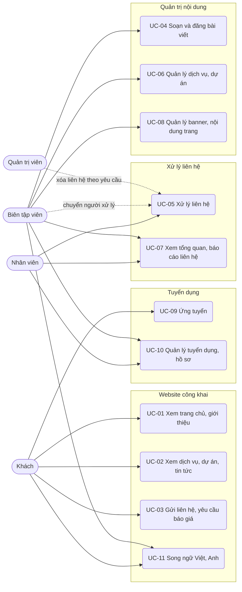

# Đặc tả use case — Website Công ty

> Use case phần nền (UC-SYS-01 đến UC-SYS-10): `ZDOCS/03-KIEN-TRUC/USE-CASE-NEN.md`.
> Mã FR, BR, SCR tham chiếu `02-SRS.md`.

---

## 1. Tác nhân

| Tác nhân | Mã vai trò | Use case chính |
| :--- | :--- | :--- |
| Khách | — | UC-01, UC-02, UC-03, UC-09, UC-11 |
| Nhân viên | `STAFF` | UC-05, UC-07 (thẻ liên hệ của mình), UC-10 (hồ sơ ứng tuyển) |
| Biên tập viên | `MANAGER` | UC-04, UC-05 (chuyển người xử lý), UC-06, UC-07, UC-08, UC-10, UC-11 |
| Quản trị viên | `ADMIN` | Toàn bộ, cộng phần nền; xóa liên hệ theo yêu cầu của khách trong UC-05 |

---

## 2. Sơ đồ use case

---

## 3. Danh sách use case

| Mã | Tên | Tác nhân chính | Module | Ưu tiên | FR |
| :--- | :--- | :--- | :--- | :---: | :--- |
| UC-01 | Xem trang chủ, giới thiệu | Khách | Website công khai | P1 | FR-01, FR-02, FR-03, FR-04 |
| UC-02 | Xem dịch vụ, dự án, tin tức | Khách | Website công khai | P1 | FR-05, FR-06, FR-07, FR-08 |
| UC-03 | Gửi liên hệ, yêu cầu báo giá | Khách | Website công khai | P1 | FR-09, FR-10, FR-11, FR-12 |
| UC-04 | Soạn và đăng bài viết | Biên tập viên | Quản trị nội dung | P1 | FR-08, FR-24, FR-25, FR-26, FR-27, FR-28 |
| UC-05 | Xử lý liên hệ | Nhân viên | Xử lý liên hệ | P1 | FR-13, FR-14, FR-15, FR-16, FR-17, FR-18, FR-19, FR-35 |
| UC-06 | Quản lý dịch vụ, dự án | Biên tập viên | Quản trị nội dung | P1 | FR-22, FR-23, FR-26, FR-28 |
| UC-07 | Xem tổng quan, báo cáo liên hệ | Biên tập viên | Xử lý liên hệ | P1 | FR-18, FR-29, FR-30 |
| UC-08 | Quản lý banner, nội dung trang | Biên tập viên | Quản trị nội dung | P1 | FR-20, FR-21 |
| UC-09 | Ứng tuyển | Khách | Tuyển dụng | P2 | FR-31 |
| UC-10 | Quản lý tuyển dụng, hồ sơ | Biên tập viên, Nhân viên | Tuyển dụng | P2 | FR-32, FR-33 |
| UC-11 | Song ngữ Việt, Anh | Khách, Biên tập viên | Website công khai | P3 | FR-34 |

---

## 4. Đặc tả chi tiết

### UC-01: Xem trang chủ, giới thiệu

| Mục | Nội dung |
| :--- | :--- |
| Tác nhân chính | Khách |
| Mô tả | Khách xem tổng quan công ty, năng lực, đội ngũ và liên hệ nhanh |
| Ưu tiên | P1 |
| Điều kiện kích hoạt | Khách mở website từ Google, Zalo, Facebook hoặc danh thiếp |
| Tiền điều kiện | Không cần đăng nhập |
| Hậu điều kiện | Không thay đổi dữ liệu |
| Yêu cầu liên quan | FR-01, FR-02, FR-03, FR-04, BR-14, BR-15, BR-16 |
| Màn hình | SCR-01, SCR-02 |

**Luồng chính**

1. Khách mở website trên điện thoại; hệ thống hiển thị đầu trang có logo, nút menu, hotline.
2. Banner đầu trang tự chuyển sau 6 giây; khách vuốt để chuyển, bấm nút trên banner để tới trang đích.
3. Khách cuộn qua các khối: giới thiệu ngắn, dịch vụ nổi bật, con số ấn tượng, dự án nổi bật, logo khách hàng, 3 bài viết mới, khối "Nhận tư vấn miễn phí".
4. Khách mở menu, chọn "Giới thiệu"; hệ thống hiển thị lịch sử hình thành, tầm nhìn, sứ mệnh, giá trị cốt lõi, đội ngũ lãnh đạo, chứng nhận.
5. Khách bấm nút nổi Gọi điện hoặc Zalo để liên hệ ngay.

**Luồng thay thế**

- 2a. Không có banner nào Đang hiển thị: khối banner thay bằng ảnh tĩnh mặc định kèm tên công ty và khẩu hiệu.
- 5a. Trên máy tính: nút Gọi điện hiển thị số hotline; nút Zalo mở `https://zalo.me/{số}` trong tab mới.
- 5b. Khách bấm "Nhận tư vấn miễn phí": chuyển sang UC-03.

**Luồng ngoại lệ**

- E1. Ảnh banner lỗi tải: hệ thống hiển thị nền màu thương hiệu kèm tiêu đề banner, bố cục không vỡ.

### UC-02: Xem dịch vụ, dự án, tin tức

| Mục | Nội dung |
| :--- | :--- |
| Tác nhân chính | Khách |
| Mô tả | Khách tìm hiểu dịch vụ, xem dự án đã làm, đọc và chia sẻ bài viết |
| Ưu tiên | P1 |
| Điều kiện kích hoạt | Khách bấm menu, thẻ dịch vụ, thẻ dự án hoặc mở link bài viết được chia sẻ |
| Tiền điều kiện | Nội dung đang hiển thị (BR-11) |
| Hậu điều kiện | Lượt xem bài viết được ghi (BR-13) |
| Yêu cầu liên quan | FR-05, FR-06, FR-07, FR-08, BR-08, BR-11, BR-12, BR-13, BR-17 |
| Màn hình | SCR-03, SCR-04, SCR-05, SCR-06, SCR-07, SCR-08 |

**Luồng chính**

1. Khách mở Dịch vụ; hệ thống hiển thị 6 dịch vụ dạng thẻ có biểu tượng, mô tả ngắn, giá tham khảo.
2. Khách chọn một dịch vụ; trang chi tiết hiển thị nội dung, các bước quy trình, giá tham khảo, câu hỏi thường gặp, dự án liên quan, nút "Nhận báo giá".
3. Khách mở Dự án, lọc theo loại công trình và năm hoàn thành; hệ thống cập nhật lưới, đường dẫn giữ bộ lọc.
4. Khách chọn một dự án; trang chi tiết hiển thị loại công trình, địa điểm, diện tích, năm, mô tả và thư viện ảnh.
5. Khách mở Tin tức, chọn chuyên mục, mở một bài; trang hiển thị ngày đăng, thời gian đọc, nội dung, 3 bài liên quan, nút chia sẻ.

**Luồng thay thế**

- 4a. Khách bấm ảnh dự án: hộp xem ảnh phóng to mở ra, vuốt hoặc bấm phím mũi tên để chuyển ảnh.
- 5a. Khách gõ từ khóa ở ô tìm kiếm Tin tức: hệ thống hiển thị bài có tiêu đề hoặc tóm tắt chứa từ khóa.
- 5b. Khách bấm chia sẻ Zalo, Facebook hoặc sao chép link; link gửi đi hiện ảnh và tiêu đề xem trước (FR-08).
- 1a. Khách mở link có slug cũ: hệ thống chuyển hướng 301 tới slug mới (BR-08).

**Luồng ngoại lệ**

- E1. Nội dung không tồn tại, đang ẩn, bài Nháp hoặc Đã gỡ: hệ thống hiển thị trang 404 có ô tìm kiếm và link về trang chủ.
- E2. Bộ lọc dự án không có kết quả: hiển thị "Chưa có dự án phù hợp" và nút "Xóa bộ lọc".

### UC-03: Gửi liên hệ, yêu cầu báo giá

| Mục | Nội dung |
| :--- | :--- |
| Tác nhân chính | Khách |
| Mô tả | Khách để lại thông tin để được tư vấn, báo giá |
| Ưu tiên | P1 |
| Điều kiện kích hoạt | Khách bấm "Nhận báo giá", "Tư vấn công trình tương tự" hoặc mở trang Liên hệ |
| Tiền điều kiện | Không cần đăng nhập |
| Hậu điều kiện | Liên hệ trạng thái Mới có mã theo BR-04; chuông thông báo ở trang quản trị tăng 1 |
| Yêu cầu liên quan | FR-09, FR-10, FR-11, FR-12, BR-01, BR-02, BR-03, BR-04, BR-06 |
| Màn hình | SCR-09, SCR-10 |

**Luồng chính**

1. Khách mở trang Liên hệ; hệ thống hiển thị địa chỉ, điện thoại, email, giờ làm việc, bản đồ và form.
2. Khách nhập họ tên, số điện thoại, email (không bắt buộc), chọn dịch vụ quan tâm, ngân sách dự kiến, nhập diện tích (không bắt buộc), nội dung; tick ô đồng ý xử lý dữ liệu cá nhân.
3. Hệ thống kiểm tra từng ô khi khách rời ô (BR-01, BR-02).
4. Khách bấm "Gửi"; hệ thống kiểm tra theo BR-03, lưu liên hệ trạng thái Mới, mã `LH` theo BR-04, nguồn "Trang Liên hệ".
5. Hệ thống hiển thị "Cảm ơn {họ tên}. Mã yêu cầu của anh/chị là {mã}. Chúng tôi sẽ liên hệ trong vòng 24 giờ."
6. Hệ thống ghi email xác nhận gửi khách (nếu có email) và email báo hộp thư nhận liên hệ vào nhật ký với nhãn "Email giả lập"; chuông thông báo ở trang quản trị tăng 1.

**Luồng thay thế**

- 1a. Khách bấm "Nhận báo giá" ở trang chi tiết dịch vụ: hệ thống mở form dạng hộp thoại, dịch vụ quan tâm chọn sẵn, nguồn "Nhận báo giá".
- 1b. Khách bấm "Tư vấn công trình tương tự" ở trang dự án: nội dung điền sẵn "Tôi muốn làm công trình tương tự {tên dự án}", nguồn "Dự án tương tự".
- 4a. Cùng số điện thoại đã có liên hệ Mới hoặc Đang xử lý trong 24 giờ: hệ thống không tạo liên hệ mới, ghi nội dung vào nhật ký liên hệ cũ với dòng "Khách gửi lại"; khách thấy thông báo thành công với mã cũ.

**Luồng ngoại lệ**

- E1. Số điện thoại sai định dạng: báo "Số điện thoại chưa đúng" tại ô.
- E2. Chưa tick ô đồng ý: nút "Gửi" bị vô hiệu.
- E3. Cùng địa chỉ IP gửi lần thứ 4 trong 10 phút: báo "Anh/chị đã gửi nhiều lần, vui lòng thử lại sau 10 phút hoặc gọi hotline", không lưu.
- E4. Trường bẫy bot có dữ liệu: hệ thống hiển thị thành công, lưu liên hệ trạng thái Spam, không ghi email, không tăng chuông.
- E5. Mất kết nối khi gửi: giữ nguyên dữ liệu đã nhập, báo "Chưa gửi được, vui lòng thử lại"; gửi lại không tạo trùng (NFR-05).

### UC-04: Soạn và đăng bài viết

| Mục | Nội dung |
| :--- | :--- |
| Tác nhân chính | Biên tập viên |
| Mô tả | Viết bài, chèn ảnh, tối ưu SEO, đăng ngay hoặc hẹn giờ |
| Ưu tiên | P1 |
| Điều kiện kích hoạt | Công ty có tin mới, bài kiến thức, dự án vừa bàn giao |
| Tiền điều kiện | Có quyền `posts.create` và `posts.publish` |
| Hậu điều kiện | Bài Đã đăng xuất hiện ở Tin tức và `sitemap.xml` trong 60 giây (NFR-04) |
| Yêu cầu liên quan | FR-08, FR-24, FR-25, FR-26, FR-27, FR-28, BR-08, BR-09, BR-10, BR-11, BR-12, BR-14, BR-16, BR-18 |
| Màn hình | SCR-19, SCR-20, SCR-21, SCR-08 |

**Luồng chính**

1. Biên tập viên mở Bài viết, bấm "Viết bài".
2. Nhập tiêu đề; hệ thống tự sinh slug (BR-08).
3. Soạn nội dung trong trình soạn thảo: tiêu đề mục, đoạn văn, danh sách, bảng, link, video YouTube; chèn ảnh từ thư viện hoặc tải ảnh mới.
4. Chọn chuyên mục, thẻ, ảnh đại diện kèm văn bản thay thế, nhập tóm tắt.
5. Mở khu SEO; hệ thống điền sẵn tiêu đề SEO, mô tả meta theo BR-09, hiển thị bản xem trước kết quả Google và bộ đếm ký tự.
6. Bấm "Xem trước"; hệ thống mở bài như trên website, có nút chuyển khung điện thoại và máy tính.
7. Bấm "Đăng ngay"; hệ thống kiểm tra BR-10, chuyển bài sang Đã đăng, ghi ngày đăng, bài xuất hiện đầu trang Tin tức.

**Luồng thay thế**

- 1a. Sửa bài đã đăng: lưu thay đổi; ngày đăng giữ nguyên, trang bài hiện "Cập nhật dd/MM/yyyy" (BR-11).
- 1b. Gỡ bài: bấm "Gỡ bài", xác nhận; bài chuyển Đã gỡ, trang công khai trả 404.
- 1c. Quản lý chuyên mục: mở tab Chuyên mục, thêm, sửa, kéo thả thứ tự, ẩn.
- 2a. Đổi slug của bài đã đăng: hệ thống cảnh báo link cũ sẽ chuyển hướng và lưu slug cũ (BR-08).
- 4a. Bật "Ghim bài": bài ghim cũ tự bỏ ghim (BR-16).
- 7a. Hẹn giờ: chọn ngày giờ đăng; bài chuyển Hẹn giờ; đến giờ hệ thống tự đăng.
- 7b. Lưu nháp: bài ở trạng thái Nháp; trình soạn thảo tự lưu mỗi 30 giây (NFR-06).

**Luồng ngoại lệ**

- E1. Thiếu điều kiện đăng, vd chưa có ảnh đại diện hoặc nội dung dưới 300 ký tự: hệ thống liệt kê từng mục thiếu, bài giữ trạng thái Nháp.
- E2. Giờ hẹn chưa cách hiện tại ít nhất 5 phút: báo lỗi tại ô giờ hẹn.
- E3. Slug trùng: báo lỗi tại ô slug, gợi ý thêm `-2`.
- E4. Ảnh sai định dạng hoặc quá 5 MB: từ chối ảnh đó, báo lý do.
- E5. Tiêu đề SEO trên 60 ký tự hoặc mô tả meta trên 160 ký tự: cảnh báo vàng, vẫn lưu và đăng được.
- E6. Xóa bài đã từng đăng: nút "Xóa" bị vô hiệu, gợi ý dùng "Gỡ bài" (BR-18).

### UC-05: Xử lý liên hệ

| Mục | Nội dung |
| :--- | :--- |
| Tác nhân chính | Nhân viên |
| Tác nhân phụ | Biên tập viên, Quản trị viên (chuyển người xử lý); Quản trị viên (xóa liên hệ) |
| Mô tả | Nhận liên hệ, gọi lại khách, ghi nhật ký chăm sóc, chốt kết quả |
| Ưu tiên | P1 |
| Điều kiện kích hoạt | Chuông thông báo có liên hệ mới, hoặc đến giờ hẹn gọi lại |
| Tiền điều kiện | Có quyền `contacts.view` và `contacts.update` |
| Hậu điều kiện | Liên hệ có người xử lý, có nhật ký; khi hoàn tất có kết quả Tiềm năng hoặc Không phù hợp |
| Yêu cầu liên quan | FR-13, FR-14, FR-15, FR-16, FR-17, FR-18, FR-19, FR-35, BR-05, BR-06, BR-07, BR-22 |
| Màn hình | SCR-14 |

**Luồng chính**

1. Nhân viên thấy chuông thông báo có số liên hệ mới, mở Quản lý liên hệ; danh sách mặc định lọc "Mới" và "Của tôi", mới nhất lên đầu, liên hệ Quá hạn có nhãn đỏ.
2. Nhân viên chọn một liên hệ Mới; ngăn chi tiết hiển thị họ tên, số điện thoại, email, nguồn, dịch vụ quan tâm, ngân sách, diện tích, nội dung, trang khách gửi.
3. Nhân viên bấm "Nhận xử lý"; liên hệ chuyển Đang xử lý, gán cho nhân viên, ghi thời điểm nhận.
4. Nhân viên bấm số điện thoại để gọi hoặc mở Zalo; sau khi liên lạc, thêm nhật ký chăm sóc: kênh, kết quả liên lạc, nội dung, giờ hẹn gọi lại nếu có.
5. Khi tư vấn xong, nhân viên bấm "Hoàn tất", chọn kết quả Tiềm năng hoặc Không phù hợp, nhập ghi chú; liên hệ chuyển Đã xử lý.

**Luồng thay thế**

- 1a. Biên tập viên xuất Excel danh sách đang lọc (quyền `contacts.export`); hệ thống ghi nhật ký người xuất, bộ lọc, số dòng.
- 3a. Biên tập viên hoặc Quản trị viên bấm "Chuyển người xử lý", chọn nhân viên khác; liên hệ xuất hiện trong "Của tôi" của người được giao.
- 4a. Đến giờ hẹn gọi lại: liên hệ lên đầu danh sách "Của tôi" với nhãn "Đến hẹn"; qua giờ hẹn mà chưa có nhật ký mới thì đổi nhãn "Trễ hẹn" (BR-06).
- 2a. Liên hệ rác (quảng cáo, gọi nhầm): bấm "Đánh dấu spam"; khôi phục được về Mới.
- 5a. Khách gọi lại sau khi đã hoàn tất: bấm "Mở lại", nhập lý do; liên hệ về Đang xử lý.
- 5b. Khách yêu cầu xóa dữ liệu cá nhân: Quản trị viên bấm "Xóa vĩnh viễn", nhập lý do, xác nhận (BR-22).

**Luồng ngoại lệ**

- E1. Liên hệ vừa được người khác nhận: hệ thống báo "Liên hệ đã được {tên} nhận" và tải lại danh sách (BR-07).
- E2. Bấm "Hoàn tất" khi chưa có nhật ký chăm sóc: báo "Cần ít nhất 1 nhật ký chăm sóc trước khi hoàn tất".
- E3. Ghi chú kết quả dưới 10 ký tự hoặc mở lại không nhập lý do: nút xác nhận bị vô hiệu.
- E4. Nhân viên mở link chi tiết của liên hệ đang giao cho người khác: hệ thống báo không có quyền xem (BR-07).

### UC-06: Quản lý dịch vụ, dự án

| Mục | Nội dung |
| :--- | :--- |
| Tác nhân chính | Biên tập viên |
| Mô tả | Thêm, sửa, ẩn, sắp xếp dịch vụ và dự án tiêu biểu |
| Ưu tiên | P1 |
| Điều kiện kích hoạt | Bàn giao công trình mới, đổi bảng giá, thêm dịch vụ |
| Tiền điều kiện | Có quyền `services.update` hoặc `projects.update` |
| Hậu điều kiện | Trang công khai cập nhật trong 60 giây (NFR-04) |
| Yêu cầu liên quan | FR-22, FR-23, FR-26, FR-28, BR-08, BR-09, BR-14, BR-16, BR-17, BR-18 |
| Màn hình | SCR-17, SCR-18, SCR-21 |

**Luồng chính (thêm dự án)**

1. Biên tập viên mở Dự án, bấm "Thêm dự án".
2. Nhập tên, chọn loại công trình, 1–3 dịch vụ, nhập địa điểm, năm hoàn thành, diện tích, mô tả; hệ thống tự sinh slug.
3. Tải ảnh bìa kèm văn bản thay thế và bộ ảnh tối đa 20 ảnh; kéo thả để sắp thứ tự ảnh.
4. Bật "Nổi bật trang chủ" nếu muốn; kiểm tra khu SEO.
5. Bấm "Lưu và hiển thị"; dự án xuất hiện ở trang Dự án và ở trang chủ nếu nổi bật.

**Luồng thay thế**

- 1a. Dịch vụ: mở Dịch vụ, thêm hoặc sửa tên, biểu tượng, ảnh, mô tả, các bước quy trình, giá tham khảo và đơn vị tính (BR-17), câu hỏi thường gặp.
- 1b. Sắp xếp: kéo thả dịch vụ hoặc dự án trong danh sách; trang công khai hiển thị theo thứ tự mới.
- 1c. Ẩn: tắt "Hiển thị"; nội dung biến mất khỏi trang công khai và `sitemap.xml`, link trả 404.
- 5a. Bấm "Lưu nháp": dự án lưu ở trạng thái ẩn để hoàn thiện sau.

**Luồng ngoại lệ**

- E1. Bật nổi bật cho dự án hoặc dịch vụ thứ 7: báo "Trang chủ hiển thị tối đa 6, hãy bỏ bớt một mục" (BR-16).
- E2. Xóa dịch vụ đang gắn với dự án hoặc liên hệ: từ chối, gợi ý dùng "Ẩn" (BR-18).
- E3. Bộ ảnh vượt 20 ảnh, ảnh bìa thiếu văn bản thay thế: báo lỗi, không lưu.
- E4. Giá tham khảo không phải bội số 1.000 ₫: báo lỗi tại ô giá.

### UC-07: Xem tổng quan, báo cáo liên hệ

| Mục | Nội dung |
| :--- | :--- |
| Tác nhân chính | Biên tập viên |
| Tác nhân phụ | Nhân viên (chỉ thẻ liên hệ của mình) |
| Mô tả | Nắm nhanh việc cần làm hôm nay và hiệu quả website mang khách về |
| Ưu tiên | P1 |
| Tiền điều kiện | Có quyền `dashboard.view`; biểu đồ, tỉ lệ cần `reports.view` |
| Hậu điều kiện | Không thay đổi dữ liệu |
| Yêu cầu liên quan | FR-18, FR-29, FR-30, BR-06, BR-13, BR-21 |
| Màn hình | SCR-13, SCR-22 |

**Luồng chính**

1. Biên tập viên đăng nhập; hệ thống mở Tổng quan quản trị với 4 thẻ: liên hệ mới hôm nay, chưa nhận, quá hạn, tỉ lệ tiềm năng 30 ngày.
2. Hệ thống hiển thị biểu đồ cột liên hệ 30 ngày chia theo nguồn, 5 liên hệ mới nhất, 5 bài viết xem nhiều nhất 30 ngày, bài hẹn giờ sắp đăng.
3. Biên tập viên bấm thẻ "Quá hạn"; hệ thống mở Quản lý liên hệ lọc sẵn liên hệ quá hạn.
4. Biên tập viên mở Báo cáo liên hệ, chọn khoảng ngày; hệ thống hiển thị báo cáo theo ngày, nguồn, dịch vụ, ngân sách, người xử lý theo BR-21.

**Luồng thay thế**

- 1a. Nhân viên đăng nhập: chỉ thấy thẻ Mới chưa nhận, Của tôi đang xử lý, Quá hạn, Trễ hẹn của tôi và 5 liên hệ mới nhất; không có tỉ lệ, biểu đồ, bài viết.
- 4a. Bấm "Xuất Excel": tải file báo cáo đang xem.

**Luồng ngoại lệ**

- E1. Khoảng ngày dài hơn 366 ngày: báo lỗi, yêu cầu chọn lại.
- E2. Khoảng ngày không có liên hệ: biểu đồ hiển thị trạng thái trống, tỉ lệ hiển thị "—".

### UC-08: Quản lý banner, nội dung trang

| Mục | Nội dung |
| :--- | :--- |
| Tác nhân chính | Biên tập viên |
| Mô tả | Đổi banner khuyến mãi, sửa nội dung trang chủ, giới thiệu, liên hệ không cần lập trình viên |
| Ưu tiên | P1 |
| Điều kiện kích hoạt | Chạy chương trình ưu đãi, đổi số liệu công ty, thêm thành viên đội ngũ |
| Tiền điều kiện | Có quyền `banners.update` hoặc `pages.update` |
| Hậu điều kiện | Trang chủ, giới thiệu, liên hệ cập nhật trong 60 giây |
| Yêu cầu liên quan | FR-20, FR-21, BR-14, BR-15 |
| Màn hình | SCR-15, SCR-16, SCR-21 |

**Luồng chính (thêm banner)**

1. Biên tập viên mở Banner; danh sách hiển thị ảnh nhỏ, tiêu đề, khoảng hiển thị, trạng thái (Tắt, Chờ hiển thị, Đang hiển thị, Hết hạn), thứ tự.
2. Bấm "Thêm banner"; tải ảnh máy tính (1920×800 khuyến nghị), ảnh điện thoại (800×1000, không bắt buộc), nhập văn bản thay thế, tiêu đề, mô tả, nhãn nút, link, khoảng hiển thị.
3. Bật banner, kéo thả để sắp thứ tự, bấm "Lưu".
4. Hệ thống kiểm tra BR-14, BR-15, lưu; trang chủ hiển thị banner khi tới ngày bắt đầu.

**Luồng thay thế**

- 1a. Nội dung trang: mở Nội dung trang, chọn tab Trang chủ (giới thiệu ngắn, 4 con số ấn tượng, logo khách hàng), tab Giới thiệu (các khối, đội ngũ, chứng nhận) hoặc tab Liên hệ (giờ làm việc, link bản đồ, mạng xã hội); sửa, bấm "Xem trước", rồi "Lưu".
- 3a. Tắt banner: banner chuyển Tắt, biến mất khỏi trang chủ ngay ở lần tải kế tiếp.

**Luồng ngoại lệ**

- E1. Bật banner khi đã có 5 banner Chờ hiển thị hoặc Đang hiển thị: báo "Tối đa 5 banner đang bật" (BR-15).
- E2. Ảnh máy tính rộng dưới 1440 px hoặc thiếu văn bản thay thế: báo lỗi, không lưu.
- E3. Ngày kết thúc trước ngày bắt đầu: báo lỗi tại ô ngày.

### UC-09: Ứng tuyển

| Mục | Nội dung |
| :--- | :--- |
| Tác nhân chính | Khách |
| Mô tả | Ứng viên xem tin tuyển dụng và nộp CV |
| Ưu tiên | P2 |
| Yêu cầu liên quan | FR-31, BR-01, BR-04, BR-19, BR-20 |
| Màn hình | SCR-11, SCR-12 |

**Luồng chính**

1. Khách mở Tuyển dụng; hệ thống hiển thị tin Đang tuyển kèm vị trí, nơi làm việc, mức lương, hạn nộp.
2. Khách mở một tin; hệ thống hiển thị mô tả công việc, yêu cầu, quyền lợi và form ứng tuyển.
3. Khách nhập họ tên, số điện thoại, email, tải CV, viết thư giới thiệu (không bắt buộc), bấm "Nộp hồ sơ".
4. Hệ thống kiểm tra BR-20, lưu hồ sơ trạng thái Mới với mã `UV`, hiển thị "Đã nhận hồ sơ, mã {mã}"; ghi email xác nhận (giả lập).

### UC-10: Quản lý tuyển dụng, hồ sơ

| Mục | Nội dung |
| :--- | :--- |
| Tác nhân chính | Biên tập viên (tin tuyển dụng), Nhân viên (hồ sơ ứng tuyển) |
| Mô tả | Đăng tin tuyển dụng, sàng lọc hồ sơ ứng viên |
| Ưu tiên | P2 |
| Yêu cầu liên quan | FR-32, FR-33, BR-19 |
| Màn hình | SCR-23 |

**Luồng chính**

1. Biên tập viên mở Tuyển dụng, bấm "Thêm tin"; nhập vị trí, phòng ban, nơi làm việc, số lượng, lương từ–đến, kinh nghiệm, hạn nộp, mô tả, yêu cầu, quyền lợi; bấm "Đăng tin".
2. Hệ thống hiển thị tin ở trang Tuyển dụng; qua 23:59 ngày hạn nộp tin tự chuyển Hết hạn.
3. Nhân viên mở tab Hồ sơ, lọc theo tin; mở hồ sơ thì trạng thái chuyển Đã xem; tải CV.
4. Nhân viên đổi trạng thái Hẹn phỏng vấn, Đạt hoặc Không đạt, ghi chú.
